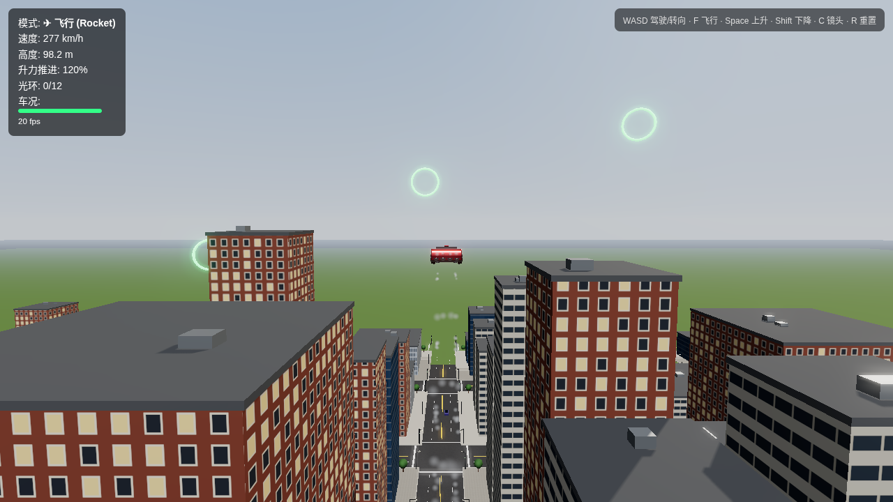

# 飞行汽车城市游戏（Three.js）

一个用 Three.js 做的网页 3D 飞行汽车游戏：驾驶一辆受新一代 Tesla Roadster（SpaceX 冷气推进器）启发的飞行跑车，在带车道线、斑马线、红绿灯和车流的城市里开车或起飞，穿过空中光环得分。

在线试玩：https://mr-funny.github.io/flying-car-game/

## 操作

- WASD：驾驶 / 转向
- F：切换道路 / 飞行模式
- 空格：上升；Shift：下降
- C：切换镜头
- R：车辆损毁后重来
- 手机 / 平板：屏幕虚拟摇杆和按钮

## 说明

车辆外形和推进器布局是根据媒体文字报道（MotorTrend、CNBC、路透等）推测制作的，并非官方设计，比例和细节可能与实车不同。
